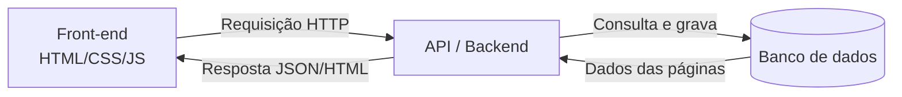

### Grupo
- Almir
- Vânia
- Max

# 🚚 Truck Place

> Aplicativo web de catálogo, com backend robusto, para divulgar Food Trucks e Polos Gastronômicos de Fortaleza e Região Metropolitana.

## Sumário

1. [Briefing](#briefing)
2. [Arquitetura e Backend (núcleo do projeto)](#arquitetura-e-backend)
3. [Público-Alvo](#público-alvo)
4. [Análise de Concorrentes](#análise-de-concorrentes)

---

# Briefing
### Grupo

- Almir
- Vânia
- Max

### Quem é o cliente?

Truck Place

### Qual é o problema?

Falta de conhecimento da população sobre Food Trucks.

### Qual é o objetivo?

Disseminar informações como localização e promoções sobre Food Trucks e Polos Gastronômicos em Fortaleza de forma acessível.

### Quem é o público?

Jovens de 18 a 55 anos que moram em áreas nobres de Fortaleza e Região Metropolitana, gostam de sair e experimentar novidades e compartilham experiências nas redes sociais.

### O que precisa ser desenvolvido?

Aplicativo web de catálogo para apresentação e compartilhamento de informações e reviews de Food Trucks, sustentado por um **backend robusto** que armazena as páginas em banco de dados e as atualiza a partir das requisições HTTP enviadas pelo front-end.

> [!IMPORTANT]
> O backend é a parte principal e mais complexa do projeto. Veja a seção [Arquitetura e Backend](#arquitetura-e-backend).

### Quais são as necessidades?

| Área | Necessidade |
|---|---|
| Usuário | Login e cadastro |
| Comércio | Cadastro de comércio |
| Interação | Comentários, comentários com foto e sistema de review |
| Conteúdo | Catálogo de imagens |
| **Backend** | **API HTTP, persistência em banco de dados, autenticação e atualização dinâmica das páginas** |

### Quais são as restrições?

- Não podemos realizar venda para os Food Trucks.
- Apenas Food Trucks com qualificação acima da média.

### Quais são os prazos?

| Período | Entregas |
|---|---|
| **1ª semana** | Documentação, análise de mercado e público-alvo |
| **1ª metade da 2ª semana** | Desenvolvimento do HTML e primeiras páginas |
| **2ª metade da 2ª semana** | Início do desenvolvimento do CSS e JavaScript |
| **1ª metade da 3ª semana** | Fase final do desenvolvimento do CSS e JavaScript |
| **2ª metade da 3ª semana** | Review interno e refinamento da estrutura |
| **4ª semana** | Entrega |

> [!NOTE]
> O desenvolvimento do backend (API, banco de dados e integração com o front) não aparece no cronograma original. Ajustar os períodos acima para refletir quando ele foi realizado.

---

# Arquitetura e Backend

> [!IMPORTANT]
> **O backend é o núcleo deste projeto.** As páginas do Truck Place não são arquivos estáticos: elas ficam armazenadas no banco de dados e são atualizadas dinamicamente a partir de requisições HTTP enviadas pelo front-end. Esta é a parte mais complexa e mais importante da entrega.

### Visão geral

O front-end envia requisições HTTP para a API. O backend valida, processa, persiste no banco de dados e devolve o conteúdo atualizado das páginas.

### Por que é a parte principal?

- Páginas armazenadas e atualizadas no banco, não escritas fixas no código
- Toda ação do usuário (login, review, comentário, foto) passa pela API
- Concentra as regras de negócio (ex.: apenas Food Trucks com qualificação acima da média)
- Concentra segurança, validação e autenticação

### Stack do backend

| Camada | Tecnologia |
|---|---|
| Linguagem/Framework | [preencher] |
| Banco de dados | [preencher] |
| Autenticação | [preencher] |
| Upload de imagens | [preencher] |

### Endpoints principais

| Método | Rota | Descrição |
|---|---|---|
| POST | `/auth/login` | Autenticação de usuário |
| POST | `/comercios` | Cadastro de comércio |
| GET | `/food-trucks` | Lista/catálogo com filtros |
| GET | `/food-trucks/:id` | Página de um Food Truck |
| PUT | `/food-trucks/:id` | Atualiza a página |
| POST | `/food-trucks/:id/reviews` | Cria review |
| POST | `/food-trucks/:id/comentarios` | Comentário com foto |

### Modelo de dados

[diagrama ER ou lista de tabelas: usuários, comércios, páginas, reviews, comentários, imagens]

### Fluxo de uma atualização de página

1. Usuário faz uma ação no front
2. Front envia a requisição HTTP
3. Backend valida e autentica
4. Backend grava no banco
5. Backend responde e o front atualiza a tela

### Como rodar o backend

[passos de instalação, variáveis de ambiente, migrations, comando de start]

---

# Público-Alvo

### Idade e localização

18 a 55 anos, Fortaleza e Região Metropolitana (RMF).

### Necessidades diárias e hábitos de consumo

Verifica reviews e comentários antes de sair de casa. Gosta de sair e experimentar coisas novas, compartilhar experiências.

### Comportamentos e interesses pessoais

Gosta de sair, experimentar novidades, frequentar eventos e compartilhar experiências nas redes sociais.

### Poder de compra aproximado

Classes A e B, poder de compra médio a alto.

### Forma de utilização da tecnologia

Usam a tecnologia de forma constante.

---

# Análise de Concorrentes

### Identificação do concorrente

- iFood
- TripAdvisor

### Público aparente

Pessoas de 18 a 55 anos que não querem sair para consumir.

### Estrutura de páginas e interface visual

- Paginação
- Catálogo
- Interação e CSS robusto (no caso do iFood)

### Funcionalidades que oferece

- Cadastro de restaurante
- Pedidos *(não faremos)*
- Busca e filtro

### Pontos positivos

- Catálogo extenso
- Catálogo detalhado
- Navegação fácil
- Mapa com os locais
- Sistema de review robusto

### Pontos negativos

- Páginas muito simples
- Pouca interatividade
- Responsividade fraca

### Diferenciais do Truck Place

- Reconhecimento de mercado
- Regionalidade
- Poucos concorrentes na área

