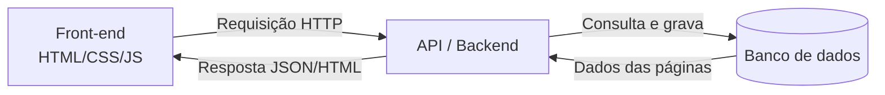

# 🚚 Truck Place

> Aplicativo web de catálogo, com backend robusto, para divulgar Food Trucks e Polos Gastronômicos de Fortaleza e Região Metropolitana.

## Sumário

1. [Briefing](#briefing)
2. [Arquitetura e Backend (núcleo do projeto)](#arquitetura-e-backend)
3. [Público-Alvo](#público-alvo)
4. [Análise de Concorrentes](#análise-de-concorrentes)

---

# Briefing

### Grupo

- Almir Dantas - Javascript
- Vânia Chaves - HTML
- Max Alexandre - CSS

### Qual é o problema?

Há uma deficiência de difusão de informações sobre Food Trucks junto à população, em especial quanto à localização, às promoções e à reputação dos estabelecimentos, o que restringe o alcance desses negócios e a descoberta deles pelo consumidor.

### Qual é o objetivo?

Consolidar-se como a principal referência na difusão de informações sobre Food Trucks e Polos Gastronômicos em Fortaleza, centralizando dados como localização, horários e promoções em uma plataforma web acessível, de navegação intuitiva e atualizada de forma dinâmica por meio da integração entre front-end e backend.

### O que precisa ser desenvolvido?

Aplicação web em formato de catálogo, voltada à apresentação e ao compartilhamento de informações, avaliações e comentários sobre Food Trucks, sustentada por um **backend robusto** que expõe uma API HTTP responsável por exibir dinamicamente o conteúdo exibido ao usuário, garantindo persistência, consistência dos dados e separação clara entre as camadas de apresentação e de regras de negócio.

# Público-Alvo

### Idade e localização

Público adulto na faixa etária de 18 a 55 anos, residente em Fortaleza e na Região Metropolitana (RMF), com concentração em áreas nobres, onde há maior densidade de consumidores com acesso constante a dispositivos conectados e propensão a explorar novas opções gastronômicas.

### Necessidades diárias e hábitos de consumo

Consumidor que adota o hábito de consultar avaliações e comentários de outros usuários como etapa prévia à decisão de consumo, utilizando essas informações para validar a qualidade e a reputação dos estabelecimentos antes de sair de casa. Apresenta perfil exploratório, com propensão a experimentar novidades gastronômicas e a compartilhar suas experiências, o que o torna tanto consumidor quanto produtor de conteúdo dentro da plataforma.

### Comportamentos e interesses pessoais

Apresenta comportamento social e exploratório, com preferência por atividades fora de casa, participação frequente em eventos e interesse recorrente em experimentar novidades gastronômicas. Utiliza ativamente as redes sociais como canal de compartilhamento de vivências, o que amplia a visibilidade espontânea dos estabelecimentos visitados e favorece a disseminação orgânica das informações publicadas na plataforma.

### Poder de compra aproximado

Consumidores pertencentes às classes A e B, com poder aquisitivo de médio a alto, o que se traduz em maior disponibilidade de renda para gastos com lazer e alimentação fora do domicílio, bem como em maior propensão a valorizar qualidade, experiência e reputação do estabelecimento no momento da escolha.

### Forma de utilização da tecnologia

Fazem uso intensivo e contínuo de tecnologia no cotidiano, com destaque para dispositivos móveis e aplicativos, utilizando-os para pesquisa, consulta de avaliações, navegação por mapas e interação em redes sociais.

> [!IMPORTANT]
> O backend é a parte principal e mais complexa do projeto. Veja a seção [Arquitetura e Backend](#arquitetura-e-backend).

### Quais são as necessidades?

| Área | Necessidade |
|---|---|
| Usuário | Login e cadastro |
| Comércio | Cadastro de comércio |
| Interação | Comentários, comentários com foto e sistema de review |
| Conteúdo | Catálogo de imagens |
| **Backend** | **API HTTP, persistência em banco de dados, autenticação e atualização dinâmica das páginas** |

### Quais são as restrições?

- Não podemos realizar venda para os Food Trucks.
- Apenas Food Trucks com qualificação acima da média.

### Quais são os prazos?

| Período | Entregas |
|---|---|
| **1ª semana** | Documentação, análise de mercado e público-alvo |
| **1ª metade da 2ª semana** | Desenvolvimento do HTML e primeiras páginas |
| **2ª metade da 2ª semana** | Início do desenvolvimento do CSS e JavaScript |
| **1ª metade da 3ª semana** | Fase final do desenvolvimento do CSS e JavaScript |
| **2ª metade da 3ª semana** | Review interno e refinamento da estrutura |
| **4ª semana** | Entrega |

> [!NOTE]
> O desenvolvimento do backend (API, banco de dados e integração com o front) não aparece no cronograma original. Ajustar os períodos acima para refletir quando ele foi realizado.

---

# Arquitetura e Backend

> [!IMPORTANT]
> **O backend é o núcleo deste projeto.** As páginas do Truck Place não são arquivos estáticos: elas ficam armazenadas no banco de dados e são atualizadas dinamicamente a partir de requisições HTTP enviadas pelo front-end. Esta é a parte mais complexa e mais importante da entrega.

### Visão geral

O front-end envia requisições HTTP para a API. O backend valida, processa, persiste no banco de dados e devolve o conteúdo atualizado das páginas.

### Por que é a parte principal?

- Páginas armazenadas e atualizadas no banco, não escritas fixas no código
- Toda ação do usuário (login, review, comentário, foto) passa pela API
- Concentra as regras de negócio (ex.: apenas Food Trucks com qualificação acima da média)
- Concentra segurança, validação e autenticação

### Stack do front e backend

| Camada | Tecnologia |
|---|---|
| Linguagem/Framework | HTML, CSS, Javascript, Express, Mongoose, JWL, express-session, connect-mongo |
| Banco de dados | MongoDB |
| Autenticação | JWL |

### Endpoints principais

| Método | Rota | Descrição |
|---|---|---|
| POST | `/auth/login` | Autenticação de usuário |
| POST | `/usuarios` | Cadastro de usuários |
| GET | `/paginas` | Lista/catálogo com filtros |
| GET | `/paginas/:slug` | Página de um Food Truck |
| POST | `/comentario/:slug` | Cria comentario |

### Modelo de dados

| Nome | Esquema |
| --- | --- |
| Usuario | Nome, Email, Senha |
| Pagina | Slug, titulo, descrição, oferece, imagem, horário, local, mapa |
| Comentario | Comentário, Timestamp |

### Fluxo de uma atualização de página

1. Usuário faz uma ação no front
2. Front envia a requisição HTTP
3. Backend valida e autentica
4. Backend grava no banco
5. Backend responde e o front atualiza a tela

---

# Análise de Concorrentes

### Identificação do concorrente

- iFood
- TripAdvisor

### Público aparente

Usuários adultos na faixa etária de 18 a 55 anos, com perfil voltado à conveniência, que priorizam o consumo sem deslocamento físico e utilizam plataformas digitais para pesquisar, comparar e adquirir produtos e serviços alimentícios a partir de qualquer localização.

### Estrutura de páginas e interface visual

- **Paginação:** listagens divididas em páginas sucessivas, o que organiza grandes volumes de resultados e reduz a carga de dados por requisição, embora possa fragmentar a navegação do usuário.
- **Catálogo:** apresentação estruturada e extensa de estabelecimentos e itens, com informações detalhadas, imagens e atributos padronizados que permitem comparação e consulta rápida.
- **Interação e CSS robusto (no caso do iFood):** interface visualmente elaborada, com componentes interativos, animações, transições e estilização avançada, que proporcionam uma experiência fluida e consistente entre diferentes dispositivos.

### Funcionalidades que oferece

- **Cadastro de restaurante:** fluxo de registro que permite ao estabelecimento criar e manter seu perfil na plataforma, com informações cadastrais, cardápio e dados de contato persistidos em banco de dados.
- **Pedidos *(fora do escopo do Truck Place)*:** processamento transacional de compras e entregas, envolvendo carrinho, pagamento e acompanhamento de status, funcionalidade que não será implementada em nosso projeto por restrição do briefing.
- **Busca e filtro:** mecanismos de consulta que permitem localizar estabelecimentos por critérios como nome, categoria, localização e avaliação, retornando resultados ordenados e refinados conforme as preferências do usuário.

### Pontos positivos

- **Catálogo extenso:** grande volume de estabelecimentos cadastrados, o que amplia as opções disponíveis ao usuário e reforça a percepção de completude e relevância da plataforma.
- **Catálogo detalhado:** páginas com informações ricas e padronizadas sobre cada estabelecimento, como descrição, imagens, avaliações e dados de contato, que reduzem a incerteza do consumidor na tomada de decisão.
- **Navegação fácil:** hierarquia de páginas clara e fluxos intuitivos, que permitem ao usuário alcançar a informação desejada com poucas interações e baixa curva de aprendizado.
- **Mapa com os locais:** integração com serviços de geolocalização que exibe visualmente a posição dos estabelecimentos, facilitando a descoberta por proximidade e o planejamento do deslocamento.
- **Sistema de review robusto:** mecanismo estruturado de avaliações e comentários dos usuários, que alimenta a reputação dos estabelecimentos e serve como principal critério de confiança na escolha.

### Pontos negativos

- **Páginas muito simples:** estrutura visual limitada e pouco elaborada, com baixa riqueza de elementos gráficos e de conteúdo, o que compromete a identidade visual e a percepção de qualidade da plataforma.
- **Pouca interatividade:** escassez de componentes dinâmicos e de feedback ao usuário, com interações restritas a navegação e consulta, o que reduz o engajamento e a participação ativa na plataforma.
- **Responsividade fraca:** adaptação insuficiente do layout a diferentes tamanhos de tela e dispositivos, o que prejudica a usabilidade em dispositivos móveis, justamente o principal meio de acesso do público-alvo.

### Diferenciais do Truck Place

- **Reconhecimento de mercado:** posicionamento do Truck Place como marca de referência no segmento de Food Trucks, o que gera confiança, favorece a adesão de estabelecimentos e usuários e facilita a divulgação orgânica da plataforma.
- **Regionalidade:** foco exclusivo em Fortaleza e na Região Metropolitana, o que permite curadoria local, dados geográficos mais precisos e conteúdo alinhado aos hábitos e às preferências do público da região, algo que plataformas de abrangência nacional não oferecem com a mesma profundidade.
- **Poucos concorrentes na área:** baixa saturação do nicho de Food Trucks e polos gastronômicos, o que reduz a barreira de entrada, amplia as chances de consolidação da plataforma e favorece a fidelização de usuários e comerciantes.
